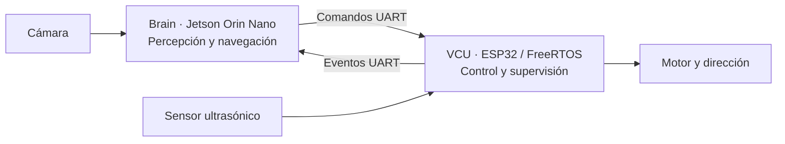

# Robot Autónomo de Laboratorio

**Vehículo autónomo a escala 1:10 · Universidad Austral**  
Proyecto final de grado con referencia en Bosch Future Mobility Challenge (BFMC).

**[Documentación completa](https://robot-autonomo-de-laboratorio-bfmc.github.io/)** · [Informe de tesis](https://robot-autonomo-de-laboratorio-bfmc.github.io/informe/portada/) · [Bitácora del proyecto](https://robot-autonomo-de-laboratorio-bfmc.github.io/timeline/)

*Raúl, el prototipo sobre la pista del laboratorio.*

Desarrollamos una plataforma que integra **visión artificial, navegación y control de bajo nivel** para recorrer un circuito a escala: seguimiento de carril, reconocimiento de señalización vial y respuesta ante obstáculos. La documentación reúne el diseño, la implementación, los ensayos y los resultados del proyecto.

## Arquitectura

Dos computadoras separan la percepción y las decisiones del control de los actuadores:

**Brain** combina detección de carril con OpenCV, control lateral PID, detección de señales con YOLO y estrategias de maniobra. Su dashboard web permite visualizar video, ajustar parámetros y supervisar el vehículo.

**VCU** ejecuta el control de motor y dirección en tareas de FreeRTOS. Incluye validación de vigencia de comandos (TTL), supervisión del enlace y parada de emergencia por ultrasonido.

[Explorar la arquitectura y sus documentos técnicos →](https://robot-autonomo-de-laboratorio-bfmc.github.io/arquitectura/)

## Componentes y repositorios

| Componente | Qué contiene | Plataforma |
| :--- | :--- | :--- |
| [**brain**](https://github.com/Robot-Autonomo-de-Laboratorio-BFMC/brain) | Percepción, navegación, maniobras y dashboard web | Jetson Orin Nano · Python |
| [**embedded**](https://github.com/Robot-Autonomo-de-Laboratorio-BFMC/embedded) | Firmware de la VCU: actuación, supervisión y comunicación serie | ESP32 · C++ · FreeRTOS |
| [**vision-artificial**](https://github.com/Robot-Autonomo-de-Laboratorio-BFMC/vision-artificial) | Entrenamiento YOLOv8, datasets e informes de evaluación | Notebooks · Colab · Docker |
| [**Documentación**](https://github.com/Robot-Autonomo-de-Laboratorio-BFMC/Robot-Autonomo-de-Laboratorio-BFMC.github.io) | Sitio técnico, informe de tesis y bitácora | MkDocs Material · GitHub Pages |

También conservamos [**brain-austral**](https://github.com/Robot-Autonomo-de-Laboratorio-BFMC/brain-austral), el código base BFMC para Raspberry Pi, con APIs y servidores simulados.

## Para profundizar

- **[Informe de tesis](https://robot-autonomo-de-laboratorio-bfmc.github.io/informe/portada/):** hardware, software, entorno de validación y resultados.
- **[Visión artificial](https://robot-autonomo-de-laboratorio-bfmc.github.io/vision/):** modelo, datasets y métricas de entrenamiento.
- **[Bitácora de laboratorio](https://robot-autonomo-de-laboratorio-bfmc.github.io/archivo/notion/jetson/):** configuración de Jetson y registro de trabajo.

---

Proyecto final de grado · Facultad de Ingeniería, Universidad Austral · 2025.  
Nicolas Visintin · Juan Francisco Pittaro · Nicolás Mangini · Iván Ostrowski.

Fotografía del proyecto: [documentación y créditos](https://robot-autonomo-de-laboratorio-bfmc.github.io/creditos/) · [CC BY 4.0](https://creativecommons.org/licenses/by/4.0/deed.es).
